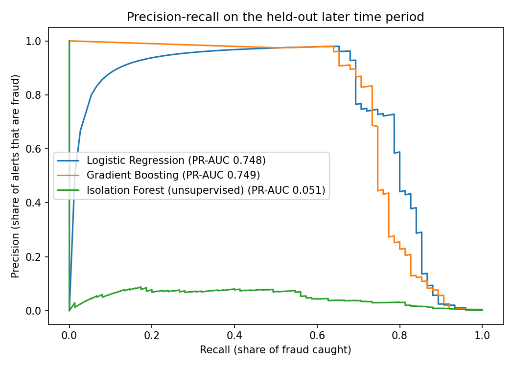
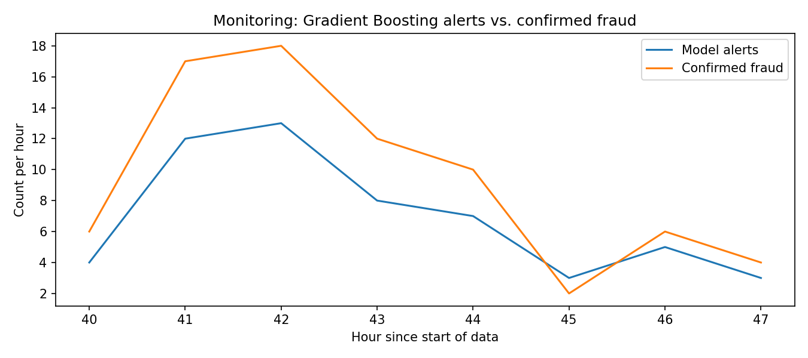

# Credit Card Fraud Detection: Evaluating Models Beyond Accuracy

Detecting fraud in 284,807 real card transactions where only **0.17%** are fraudulent. This project trains on earlier transactions and tests on later ones, evaluates models with metrics that matter for rare events, tunes decision thresholds, and adds a monitoring view of alerts over time.

## Results

On the test period (the latest 56,962 transactions, including 75 fraud cases):

| Model | PR-AUC | ROC-AUC | Precision | Recall | False alarms | Fraud caught |
|---|---|---|---|---|---|---|
| Logistic regression | 0.748 | 0.983 | 96.2% | 66.7% | 2 | 50 of 75 |
| Gradient boosting | 0.749 | 0.955 | 90.9% | 66.7% | 5 | 50 of 75 |
| Isolation Forest (unsupervised) | 0.051 | 0.954 | 7.1% | 32.0% | 314 | 24 of 75 |

Thresholds were chosen on a separate validation period to maximize F1, then applied unchanged to the test period. A model that flags nothing scores **99.87% accuracy** on this data while catching zero fraud, which is why accuracy is not used to compare models. Full results, including a second threshold rule that targets 90% precision, are in [results/results.md](results/results.md).

## Key findings

- **The simpler model held its own.** Logistic regression matched gradient boosting on PR-AUC (0.748 vs. 0.749) with fewer false alarms (2 vs. 5 among 56,887 legitimate transactions), and its coefficients are easier to explain to the analysts who review alerts.
- **Labels are valuable.** The unsupervised Isolation Forest, which never sees the fraud labels, reached only 0.05 PR-AUC, compared with 0.75 for models trained on confirmed cases.
- **Fraud patterns shift over time.** The fraud rate fell from 0.21% in the training period to 0.10% in the validation period, which is why the evaluation uses a time-based split and why ongoing monitoring matters.





## Approach

1. **Data exploration:** class balance, transaction amounts by class, and fraud rate by hour of day.
2. **Feature engineering:** log-scaled transaction amount and hour of day, alongside the 28 anonymized features (V1 to V28).
3. **Time-based split:** earliest 60% of transactions for training, next 20% for threshold tuning, latest 20% for testing, so every model is judged on future data.
4. **Models:** logistic regression (class-weighted, standardized features), histogram-based gradient boosting (class-weighted), and Isolation Forest for unsupervised anomaly detection.
5. **Evaluation beyond accuracy:** PR-AUC, ROC-AUC, precision, recall, F1, false positive rate, and alerts per 10,000 transactions.
6. **Threshold tuning:** one threshold that maximizes F1 and one that targets 90% precision, both chosen on validation data only.
7. **Monitoring:** hourly alert volume compared with confirmed fraud over the test period.
8. **Interpretability:** the logistic regression features that most strongly signal fraud.

## How to run

```bash
git clone https://github.com/Ajitkalasapur/credit-card-fraud-detection.git
cd credit-card-fraud-detection
pip install -r requirements.txt
```

1. Download `creditcard.csv` from [Kaggle](https://www.kaggle.com/datasets/mlg-ulb/creditcardfraud) into the `data/` folder (see [data/README.md](data/README.md)).
2. Open `fraud_detection.ipynb` in Jupyter or VS Code and run all cells. Charts and results are saved to `results/`.

Results above were produced with Python 3.12, pandas 3.0, and scikit-learn 1.8. Other library versions may give slightly different numbers.

## Repository structure

```
credit-card-fraud-detection/
├── fraud_detection.ipynb   # full analysis: exploration, models, evaluation, monitoring
├── requirements.txt
├── data/                   # place creditcard.csv here (not committed)
│   └── README.md
└── results/
    ├── results.md          # methodology and full metrics
    ├── results.json
    ├── pr_curves.png
    └── monitoring_hourly_alerts.png
```

## Next steps

- Cost-based thresholds that weigh missed fraud against analyst review time
- Richer behavioral features, such as transaction velocity per account
- Drift monitoring to detect when fraud patterns change

## Data

Dataset: [Credit Card Fraud Detection](https://www.kaggle.com/datasets/mlg-ulb/creditcardfraud), collected and released by the Machine Learning Group at Université Libre de Bruxelles (ULB). See the Kaggle page for license and citation details.

## Author

**Ajit Kalasapur** · M.S. Computer Engineering, Northeastern University · [LinkedIn](https://www.linkedin.com/in/ajit-kalasapur/)
